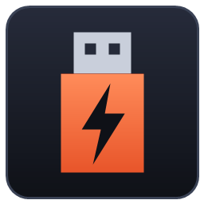

<p align="center"></p>

# USB Forge

[](https://github.com/SkippyNet/usb-forge/actions/workflows/ci.yml)
[](https://github.com/SkippyNet/usb-forge/releases/latest)
[](https://github.com/SkippyNet/usb-forge/releases)
[](LICENSE)

Build a multi-boot USB thumb drive in a few clicks. USB Forge sets up a boot menu on the drive,
then adds the operating systems and tools you pick, each one downloaded from its official project
and verified against that project's published SHA-256.

Runs on **Windows 10/11** and **Linux** (Ubuntu, Debian, Fedora, Linux Mint, Arch and other
mainstream desktops).

## Download

Get the latest build from [Releases](https://github.com/SkippyNet/usb-forge/releases/latest):

| OS | File |
|---|---|
| Windows 10/11 (x64) | `usb-forge-windows-x86_64.exe` |
| Linux (x86_64) | `usb-forge-linux-x86_64` |

The app checks for new versions when it starts. When one is available it shows
**Update & restart**. It installs the update only if the release's Ed25519 signature checks
out against the key built into the app (see [SECURITY.md](SECURITY.md)).

### Windows

Run the `.exe`. Formatting needs administrator rights, so click **Restart as administrator**
in the top-right corner.

### Linux

```sh
chmod +x usb-forge-linux-x86_64
./usb-forge-linux-x86_64
```

The app runs as your normal user and asks for your password (via polkit) only for the format
step. Requirements: `util-linux` (`lsblk`), `udisks2`, `polkit` and a kernel with exFAT
support. Every distro listed above ships these by default.

Optional desktop launcher:

```sh
install -Dm755 usb-forge-linux-x86_64 ~/.local/bin/usb-forge
install -Dm644 assets/icon.png ~/.local/share/icons/hicolor/256x256/apps/usb-forge.png
install -Dm644 packaging/linux/usb-forge.desktop ~/.local/share/applications/usb-forge.desktop
```

### Secure Boot

USB Forge shows a **"Secure Boot is on"** notice when the PC has Secure Boot enabled. Some
tools on the drive only start with Secure Boot turned off.
[docs/SECURE_BOOT.md](docs/SECURE_BOOT.md) has steps for common vendors (Dell, HP, Lenovo,
ASUS, Acer, MSI, Gigabyte, Surface and more). Firmware menus vary by model, so treat the steps
as a guide.

## Catalog

| Item | Where the version + checksum come from |
|---|---|
| Ubuntu Desktop / Server (LTS or Latest) | releases.ubuntu.com `SHA256SUMS` |
| Fedora Workstation | fedoraproject.org `releases.json` |
| Linux Mint Cinnamon | kernel.org mirror `sha256sum.txt` |
| Debian netinst | cdimage.debian.org `SHA256SUMS` |
| Hiren's BootCD PE | hirensbootcd.org download page |
| SystemRescue | system-rescue.org `.sha256` |
| Rescuezilla | GitHub release `SHA256SUM` |
| Clonezilla Live | clonezilla.org `CHECKSUMS.TXT` |
| GParted Live | gparted.org `CHECKSUMS.TXT` |
| Memtest86+ | memtest.org `sha256sum.txt` |

## The boot menu

Boot a PC from the finished drive (usually by pressing a key such as F12, F11, F9 or Esc at
power-on) and a USB Forge menu lists every ISO on the drive. Pick one and press Enter. To add
more later, copy any ISO onto the drive in Explorer or your file manager; it appears in the menu
on the next boot.

## Saved downloads

Every ISO is kept in a local downloads folder (`%LOCALAPPDATA%\UsbForge\cache` on Windows,
`~/.cache/usb-forge` on Linux) and re-checked against the official SHA-256 before each use, so
building another drive doesn't download it again. Items already saved show **✔ saved**.
Interrupted downloads resume where they stopped. The checksum still covers the whole file.

## Disk safety

- Only USB disks are listed. The disk that holds the running OS, the boot disk, and any disk the
  system uses (Windows system disk; on Linux, anything mounted outside `/media`, `/run/media` or
  `/mnt`, including swap) are hidden.
- Everything is downloaded and verified **before** the drive is touched.
- The target disk is checked again right before formatting, and you have to type `ERASE`.
- Each ISO is hashed again after it is copied to the drive.

## FAQ

**Windows says "Windows protected your PC".**
SmartScreen warns about apps it hasn't seen often. Click **More info → Run anyway**. Every
release is signed with the project's own key (verified by the app's updater) and lists SHA-256
checksums in `SHA256SUMS.txt` next to the downloads.

**My USB drive isn't listed.**
Only USB disks that the running system doesn't use are shown. Run `usb-forge --list-disks` to see
every disk and why it was hidden, and include that output if you open an issue.

**Why does my drive look almost empty in Explorer?**
You only see the data partition, which holds the ISOs and a small `ventoy` folder with the
boot menu settings. The boot menu itself lives in a second, small partition that Windows hides.

**Can I still use the drive for files?**
Yes. Anything that isn't a bootable image is ignored by the boot menu.

**A tool doesn't start and the PC mentions Secure Boot.**
See [docs/SECURE_BOOT.md](docs/SECURE_BOOT.md).

**How do I update the ISOs on a drive?**
Build the drive again. Saved downloads that are still current are reused, so only new versions
are downloaded.

## Credits

USB Forge only downloads and arranges other people's work. Thanks to the projects in the catalog
for building it and for publishing checksums that make verified downloads possible:
[Ubuntu](https://ubuntu.com), [Fedora](https://fedoraproject.org),
[Linux Mint](https://linuxmint.com), [Debian](https://www.debian.org),
[Hiren's BootCD PE](https://www.hirensbootcd.org), [SystemRescue](https://www.system-rescue.org),
[Rescuezilla](https://rescuezilla.com), [Clonezilla](https://clonezilla.org),
[GParted](https://gparted.org) and [Memtest86+](https://memtest.org). If a tool saves your day,
consider supporting its project.

## Building from source

```sh
cargo build --release          # uses the toolchain pinned in rust-toolchain.toml
cargo test --workspace
```

Diagnostics that never write to a disk:

```sh
usb-forge --version
usb-forge --list-disks   # every disk and whether it counts as a safe target
usb-forge --resolve      # latest version, URL and SHA-256 of every catalog item
```

To regenerate the icon on Windows, run `powershell -File assets/make-icon.ps1`.

## Releasing (maintainers)

1. Bump `version` in `Cargo.toml` through a PR and merge it.
2. Tag the merge commit: `git tag v0.2.0 && git push origin v0.2.0` (only admins can push `v*` tags).
3. Approve the **release** environment deployment in the Actions run. CI builds both binaries,
   signs them and publishes the GitHub release.

## Contributing

Pull requests are welcome. See [CONTRIBUTING.md](CONTRIBUTING.md). Licensed under [MIT](LICENSE).
